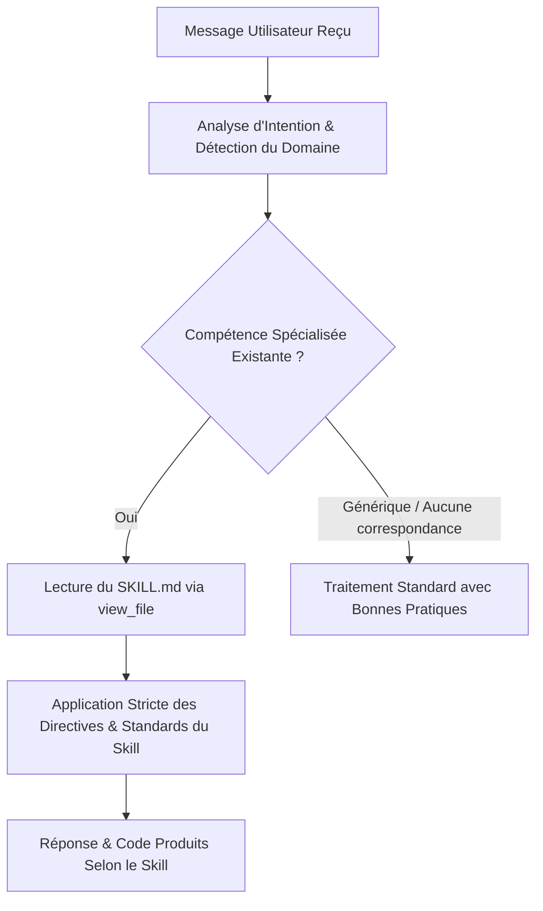

# Universal Auto-Skill Activator & Intelligent Router

Ce méta-skill garantit que **l'IA utilise automatiquement et de façon proactive la compétence la plus adaptée** pour chaque requête utilisateur, sans que l'utilisateur n'ait besoin de spécifier le nom du skill.

---

## 1. Protocole d'Activation Systématique (Mandatory Workflow)

Pour chaque message utilisateur :



### Règles d'Or :
1. **Zéro supposition** : Si la tâche touche à un domaine couvert par une compétence (GMAO, Cybersécurité, Excel, Unity, Spec, API, etc.), l'IA **DOIT** lire le `SKILL.md` correspondant avant de générer le code ou la réponse.
2. **Qualité & Conformité** : Suivre les contraintes strictes du skill (pas de raccourcis, respect des anti-rationalization patterns, utilisation de ScriptableObjects en Unity, zéro erreur de formule en Excel, etc.).

---

## 2. Matrice d'Aiguillage des 1 200+ Compétences par Domaine

### 🏭 A. Industrie, GMAO & Convergence OT/IT
* **Mots-clés** : GMAO, CMMS, Prodeos, automates, SCADA, PLC, Modbus, OPC-UA, TRS, OEE, maintenance préventive, pannes.
* **Skills cibles** :
  * [`gmao-cmms-patterns`](file:///C:/Users/user/.gemini/config/skills/gmao-cmms-patterns/SKILL.md) : Schéma relationnel BDD, Work Orders, stocks, formules TRS.
  * [`prodeos-industrial-convergence`](file:///C:/Users/user/.gemini/config/skills/prodeos-industrial-convergence/SKILL.md) : UNS (Unified Namespace), FUXA, UMH, PLC4X, LibreMES, OpenEMS.

### 🛡️ B. Cybersécurité, Pentesting & Audit (800+ skills)
* **Mots-clés** : Vulnérabilité, pentest, audit sécu, exploit, injection, Active Directory, cloud security, malware, CVE, MITRE.
* **Skills cibles** :
  * [`cybersecurity-ptes-methodology`](file:///C:/Users/user/.gemini/config/skills/cybersecurity-ptes-methodology/SKILL.md) : Méthodologie PTES complète (Reconnaissance, Scan, Exploitation, PrivEsc).
  * `exploiting-*` (ex: `exploiting-sql-injection-with-sqlmap`, `exploiting-server-side-request-forgery`).
  * `hunting-*` (ex: `hunting-for-process-injection-techniques`, `hunting-for-command-and-control-beaconing`).
  * `analyzing-*` (ex: `analyzing-active-directory-acl-abuse`, `analyzing-azure-activity-logs-for-threats`).
  * `implementing-*` (ex: `implementing-secrets-scanning-in-ci-cd`, `implementing-semgrep-for-custom-sast-rules`).

### 📄 C. Documents, Tableurs & Présentations
* **Mots-clés** : Excel, xlsx, Word, docx, PowerPoint, pptx, PDF, tableaux, formules, rapports.
* **Skills cibles** :
  * [`xlsx`](file:///C:/Users/user/.gemini/config/skills/xlsx/SKILL.md) : Classeurs dynamiques openpyxl, formules strictes, modèles financiers et industriels.
  * [`docx`](file:///C:/Users/user/.gemini/config/skills/docx/SKILL.md) : Génération et mise en page Word professionnelle.
  * [`pptx`](file:///C:/Users/user/.gemini/config/skills/pptx/SKILL.md) : Présentations PowerPoint stylisées.
  * [`pdf`](file:///C:/Users/user/.gemini/config/skills/pdf/SKILL.md) : Extraction et manipulation PDF.

### 🎮 D. Jeux Vidéo & Moteurs 2D/3D
* **Mots-clés** : Unity, C#, Match-3, ferme, Farm Bloom, ScriptableObject, shaders, 2D grid, animation.
* **Skills cibles** :
  * [`unity-match3-farm-builder`](file:///C:/Users/user/.gemini/config/skills/unity-match3-farm-builder/SKILL.md) : Algorithmes Match-3, parcelles temps réel, amélioration de bâtiments, ScriptableObjects.
  * [`unity-mcp`](file:///C:/Users/user/.gemini/config/skills/unity-mcp/SKILL.md) : Outils de contrôle Unity en direct.

### 💻 E. Ingénierie Logicielle & SDLC (Addy Osmani Pack)
* **Mots-clés** : Nouveau projet, cahier des charges, découpage, refactor, simplification, test unitaire, CI/CD, Git.
* **Skills cibles** :
  * [`interview-me`](file:///C:/Users/user/.gemini/config/skills/interview-me/SKILL.md) : Cadrage interactif du besoin.
  * [`spec-driven-development`](file:///C:/Users/user/.gemini/config/skills/spec-driven-development/SKILL.md) : PRD et specs formelles avant codage.
  * [`planning-and-task-breakdown`](file:///C:/Users/user/.gemini/config/skills/planning-and-task-breakdown/SKILL.md) : Découpage en tranches verticales.
  * [`test-driven-development`](file:///C:/Users/user/.gemini/config/skills/test-driven-development/SKILL.md) : Tests d'abord (TDD).
  * [`code-simplification`](file:///C:/Users/user/.gemini/config/skills/code-simplification/SKILL.md) : Clarté et lisibilité du code.
  * [`code-review-and-quality`](file:///C:/Users/user/.gemini/config/skills/code-review-and-quality/SKILL.md) : Revue multi-critères avant fusion.

### 🎨 F. Frontend & Design
* **Mots-clés** : UI, UX, composant, CSS, design system, React, Vue, landing page, animations.
* **Skills cibles** :
  * [`frontend-design`](file:///C:/Users/user/.gemini/config/skills/frontend-design/SKILL.md) : Direction artistique sur-mesure, typographies et palettes premium.
  * [`frontend-ui-engineering`](file:///C:/Users/user/.gemini/config/skills/frontend-ui-engineering/SKILL.md) : Composants robustes et états d'interface.
  * [`theme-factory`](file:///C:/Users/user/.gemini/config/skills/theme-factory/SKILL.md) : Application de thèmes harmonieux.

### 🔬 G. Sciences, Biologie & Chimie
* **Mots-clés** : Protéine, molécule, SMILES, PDB, gène, séquence, ChEMBL, PubChem, UniProt.
* **Skills cibles** :
  * [`pubchem-database`](file:///C:/Users/user/.gemini/config/plugins/science/skills/pubchem_database/SKILL.md), [`chembl-database`](file:///C:/Users/user/.gemini/config/plugins/science/skills/chembl_database/SKILL.md), [`uniprot-database`](file:///C:/Users/user/.gemini/config/plugins/science/skills/uniprot_database/SKILL.md), [`biomolecular-structure-viewer`](file:///C:/Users/user/.gemini/config/plugins/science/skills/biomolecular_structure_viewer/SKILL.md).

---

## 3. Découverte Dynamique de Nouvelles Compétences

Si une demande spécifique ne figure pas explicitement ci-dessus, rechercher dans le catalogue :
```powershell
Get-ChildItem -Directory "C:\Users\user\.gemini\config\skills" | Where-Object { $_.Name -like "*<terme-clé>*" }
```
Une fois le dossier identifié, lire systématiquement le fichier `SKILL.md` avant d'engager le travail.
