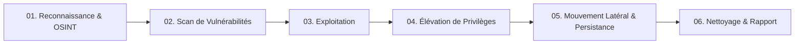

# Cybersecurity Penetration Testing & Audit Methodology (PTES / OWASP)

Ce guide opérationnel synthétise le référentiel de compétences de **[Hi-FullHouse/CyberSecurity-Skills](https://github.com/Hi-FullHouse/CyberSecurity-Skills)**, structuré selon le standard **PTES (Penetration Testing Execution Standard)**, le guide **OWASP Top 10** et les normes **NIST SP 800-115**.

---

## 1. Cycle de Vie du Test d'Intrusion (PTES)



---

## 2. Phases Opérationnelles & Boîte à Outils

### Phase 01 : Reconnaissance & Information Gathering
* **Objectif** : Cartographier la surface d'attaque externe sans déclencher d'alarmes intrusives.
* **Techniques** :
  * Énumération DNS et découverte de sous-domaines (`subfinder`, `amass`, `assetfinder`).
  * Moteurs de recherche spécialisés (Shodan, Censys, FOFA, Hunter.how).
  * Reconnaissance passive et OSINT (Whois, GitHub dorks, certificats SSL/TLS via `crt.sh`).
* **Commandes clés** :
  ```bash
  subfinder -d target.com -all -silent | httpx -title -tech-detect -status-code
  amass enum -passive -d target.com
  ```

### Phase 02 : Analyse et Scan de Vulnérabilités
* **Objectif** : Détecter les services exposés, ports ouverts et versions vulnérables.
* **Outils de référence** :
  * Ports et cartographie réseau : `nmap -sV -sC -T4 -p- target.com`
  * Scanner de vulnérabilités web/API : `nuclei -u https://target.com -severity critical,high`
  * Découverte de chemins/fichiers masqués : `ffuf -u https://target.com/FUZZ -w /path/to/wordlist.txt -mc 200,301,302`

### Phase 03 : Exploitation & Web Security (OWASP Top 10)
* **Injections SQL** : Détection et exploitation contrôlée via `sqlmap -u "https://target.com/item?id=1" --batch --dbs`
* **XSS & CSRF** : Test de contextes DOM, stockés et réfléchis.
* **SSRF (Server-Side Request Forgery)** : Rebond vers les métadonnées cloud (`http://169.254.169.254/latest/meta-data/`).
* **Authentification & JWT** : Faiblesses `none` algorithm, clés secrètes faibles, expiration token.

### Phase 04 : Élévation de Privilèges (Windows & Linux)
* **Linux** :
  * Scripts d'audit local : `LinPEAS`, `LinEnum`.
  * Recherche SUID/SGID : `find / -perm -4000 -type f 2>/dev/null`
  * Droits Sudo abusifs : `sudo -l`
* **Windows** :
  * Scripts d'audit : `WinPEAS`, `Seatbelt`, `PowerUp`.
  * Vulnérabilités de services non quotés (*Unquoted Service Paths*), DLL Hijacking, abus de privilèges de tokens (`SeImpersonatePrivilege`).

### Phase 05 : Mouvement Latéral & Active Directory
* **Cartographie du domaine** : `BloodHound` + `SharpHound` pour tracer les chemins d'attaque (*Attack Paths*).
* **Attaques Kerberos** : Kerberoasting (`GetUserSPNs.py`), AS-REP Roasting.
* **Rebond et exécution à distance** : `crackmapexec`, `impacket-psexec`, `impacket-wmiexec`.

---

## 3. Sécurité Spécifique : LLM & Agents IA (OWASP for LLM)

1. **Prompt Injection** :
   * Injections directes (tentatives de contournement des règles système).
   * Injections indirectes (documents non fiables ingérés par un RAG contenant des instructions malveillantes).
2. **Fuite de Données & Confidentialité** :
   * Extraction de prompts système, variables d'environnement ou secrets via des techniques de réitération / extraction de contexte.
3. **Contrôle d'Accès des Agents (Agentic Permissions)** :
   * Principe du moindre privilège sur l'utilisation des outils (Read-only vs Write vs Shell).
   * Isolation en bac à sable (*sandboxing*) des exécutions de commandes.

---

## 4. Structure d'un Rapport d'Audit Professionnel

1. **Résumé Exécutif (Management Summary)** : Score de risque global, principales vulnérabilités et impact métier.
2. **Tableau des Vulnérabilités** : Classification par sévérité CVSS 3.1 / 4.0 (Critique, Haute, Moyenne, Basse).
3. **Fiches d'Anomalie Détaillées** :
   * Description & Vecteur d'attaque.
   * Preuve de concept (PoC) reproductible et captures d'écran.
   * Recommandations de remédiation techniques prioritaires.
