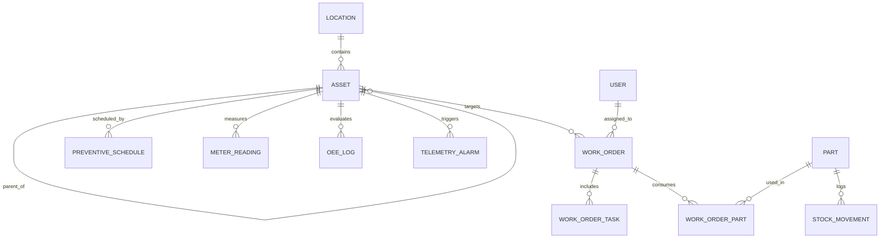

# GMAO / CMMS Architecture & Engineering Patterns

Guide d'ingénierie logicielle pour concevoir, implémenter et exploiter une **GMAO** (Gestion de Maintenance Assistée par Ordinateur) ou **CMMS** (Computerized Maintenance Management System), intégrant la convergence **OT/IT (Terrain / Automates vers Informatique)**.

---

## 1. Répertoire des Solutions Open Source Clés

### Brique 1 : Gestion de Maintenance (GMAO / CMMS)
- **[Atlas CMMS (grashjs/cmms)](https://github.com/grashjs/cmms)** : Architecture moderne API-first (Node.js/React/Mobile), gestion complète des Work Orders, codes-barres / QR codes.
- **[CMMS & OEE Software](https://github.com/opensourceoeesoftware/CMMS-OEE-Software)** : GMAO industrielle orientée calcul du TRS / OEE (Disponibilité, Performance, Qualité) et suivi des arrêts machines.
- **[SuperCMMS](https://github.com/SuperCMMS/Open-Source-CMMS)** : Schéma relationnel optimisé EAM / Asset Management et gestion des stocks de pièces détachées.
- **[GMAO Francophone (wailammar99/gmao)](https://github.com/wailammar99/gmao)** : Modèle Django REST + React adapté à la terminologie et aux processus francophones.

### Brique 2 : MES & Suivi de Production (TRS / OEE & Norme ISA-95)
- **[LibreMES (LibreMES/LibreMES)](https://github.com/LibreMES/LibreMES)** : Suivi de fabrication, qualification des causes d'arrêt machines et calcul de TRS conforme à la norme industrielle ISA-95.
- **[United Manufacturing Hub (UMH)](https://github.com/united-manufacturing-hub/united-manufacturing-hub)** : Référence open-source pour l'architecture Industrie 4.0 et le **Unified Namespace (UNS)** couplant MQTT (ingestion temps réel edge) et Apache Kafka (streaming événementiel résilient).

### Brique 3 : Passerelle Automates & Collecte de Données (IIoT / SCADA)
- **[FUXA (frangoteam/FUXA)](https://github.com/frangoteam/FUXA)** : Supervision SCADA et IHM Web open-source (Node.js/Angular/Docker). Supporte nativement OPC-UA, Modbus RTU/TCP, MQTT, Siemens S7, Ethernet/IP (Allen-Bradley) et Beckhoff ADS.
- **[Apache PLC4X (apache/plc4x)](https://github.com/apache/plc4x)** : Bibliothèque universelle de pilotes pour communiquer avec les automates industriels sans nécessiter de serveur OPC tiers propriétaire.

### Brique 4 : Énergie & Télérelève (ISO 50001 & Détection d'anomalies)
- **[OpenEMS (OpenEMS/openems)](https://github.com/OpenEMS/openems)** : Système modulaire de gestion de l'énergie (EMS) pour la télérelève, le monitoring des puissances et la détection des surconsommations mécaniques précurseurs de pannes.

---

## 2. Modèle de Données & Schéma Relationnel

### Entités Piliers



### Schéma SQL de référence (PostgreSQL / SQLite compatible)

```sql
-- 1. Localisations et Ateliers
CREATE TABLE locations (
    id SERIAL PRIMARY KEY,
    name VARCHAR(255) NOT NULL,
    code VARCHAR(50) UNIQUE NOT NULL,
    parent_id INT REFERENCES locations(id) ON DELETE SET NULL,
    description TEXT,
    created_at TIMESTAMP DEFAULT CURRENT_TIMESTAMP
);

-- 2. Équipements & Machines (Assets) avec structure arborescente
CREATE TABLE assets (
    id SERIAL PRIMARY KEY,
    code VARCHAR(100) UNIQUE NOT NULL,
    name VARCHAR(255) NOT NULL,
    parent_id INT REFERENCES assets(id) ON DELETE SET NULL,
    location_id INT REFERENCES locations(id) ON DELETE SET NULL,
    category VARCHAR(100) NOT NULL, -- Mécanique, Électrique, Pneumatique, etc.
    serial_number VARCHAR(100),
    manufacturer VARCHAR(150),
    model VARCHAR(150),
    installation_date DATE,
    criticality VARCHAR(20) DEFAULT 'MEDIUM' CHECK (criticality IN ('LOW', 'MEDIUM', 'HIGH', 'CRITICAL')),
    status VARCHAR(30) DEFAULT 'OPERATIONAL' CHECK (status IN ('OPERATIONAL', 'DEGRADED', 'DOWN', 'UNDER_MAINTENANCE', 'DECOMMISSIONED')),
    qr_code VARCHAR(255),
    uns_topic_prefix VARCHAR(255), -- Ex: enterprise/site1/area2/line3/cnc01
    created_at TIMESTAMP DEFAULT CURRENT_TIMESTAMP
);

-- 3. Ordres de Travail / Bons d'Intervention (Work Orders)
CREATE TABLE work_orders (
    id SERIAL PRIMARY KEY,
    ticket_number VARCHAR(50) UNIQUE NOT NULL, -- e.g. WO-2026-0042
    asset_id INT NOT NULL REFERENCES assets(id) ON DELETE CASCADE,
    type VARCHAR(30) NOT NULL CHECK (type IN ('CORRECTIVE', 'PREVENTIVE', 'PREDICTIVE', 'IMPROVEMENT', 'SAFETY')),
    priority VARCHAR(20) DEFAULT 'MEDIUM' CHECK (priority IN ('LOW', 'MEDIUM', 'HIGH', 'EMERGENCY')),
    status VARCHAR(30) DEFAULT 'OPEN' CHECK (status IN ('OPEN', 'PENDING_APPROVAL', 'ASSIGNED', 'IN_PROGRESS', 'ON_HOLD', 'COMPLETED', 'CLOSED', 'CANCELLED')),
    title VARCHAR(255) NOT NULL,
    description TEXT NOT NULL,
    triggered_by_alarm_id INT, -- Lien traçable avec l'alarme automate/SCADA
    assigned_technician_id INT,
    requested_by_id INT,
    scheduled_start TIMESTAMP,
    scheduled_end TIMESTAMP,
    actual_start TIMESTAMP,
    actual_end TIMESTAMP,
    downtime_minutes INT DEFAULT 0,
    root_cause TEXT,
    solution_summary TEXT,
    created_at TIMESTAMP DEFAULT CURRENT_TIMESTAMP,
    updated_at TIMESTAMP DEFAULT CURRENT_TIMESTAMP
);

-- 4. Maintenance Préventive Programmée
CREATE TABLE preventive_schedules (
    id SERIAL PRIMARY KEY,
    title VARCHAR(255) NOT NULL,
    asset_id INT NOT NULL REFERENCES assets(id) ON DELETE CASCADE,
    frequency_type VARCHAR(20) NOT NULL CHECK (frequency_type IN ('DAILY', 'WEEKLY', 'MONTHLY', 'QUARTERLY', 'YEARLY', 'METER_BASED')),
    frequency_value INT NOT NULL, -- ex: tous les 3 mois ou toutes les 500 heures
    last_run_date DATE,
    next_due_date DATE NOT NULL,
    checklist_json JSONB,
    estimated_hours DECIMAL(5,2),
    is_active BOOLEAN DEFAULT TRUE
);

-- 5. Pièces de Rechange & Stock (Spare Parts)
CREATE TABLE parts (
    id SERIAL PRIMARY KEY,
    sku VARCHAR(100) UNIQUE NOT NULL,
    name VARCHAR(255) NOT NULL,
    description TEXT,
    quantity_on_hand INT NOT NULL DEFAULT 0,
    min_quantity INT NOT NULL DEFAULT 0, -- Seuil d'alerte réapprovisionnement
    unit_cost DECIMAL(10,2) NOT NULL DEFAULT 0.00,
    storage_bin VARCHAR(50)
);

CREATE TABLE work_order_parts (
    id SERIAL PRIMARY KEY,
    work_order_id INT NOT NULL REFERENCES work_orders(id) ON DELETE CASCADE,
    part_id INT NOT NULL REFERENCES parts(id),
    quantity_used INT NOT NULL,
    unit_price DECIMAL(10,2) NOT NULL
);

-- 6. Enregistrements TRS / OEE (Overall Equipment Effectiveness)
CREATE TABLE oee_logs (
    id SERIAL PRIMARY KEY,
    asset_id INT NOT NULL REFERENCES assets(id) ON DELETE CASCADE,
    shift_date DATE NOT NULL,
    shift_name VARCHAR(50) NOT NULL, -- e.g. 'Matin', 'Après-midi', 'Nuit'
    planned_production_time_min DECIMAL(8,2) NOT NULL,
    downtime_min DECIMAL(8,2) NOT NULL DEFAULT 0,
    operating_time_min DECIMAL(8,2) GENERATED ALWAYS AS (planned_production_time_min - downtime_min) STORED,
    ideal_cycle_time_sec DECIMAL(8,4) NOT NULL,
    total_count_produced INT NOT NULL,
    defective_count INT NOT NULL DEFAULT 0,
    good_count INT GENERATED ALWAYS AS (total_count_produced - defective_count) STORED,
    availability_rate DECIMAL(6,4), -- operating_time / planned_production_time
    performance_rate DECIMAL(6,4),  -- (ideal_cycle_time * total_count) / (operating_time * 60)
    quality_rate DECIMAL(6,4),      -- good_count / total_count
    oee_rate DECIMAL(6,4)           -- availability * performance * quality
);

-- 7. Événements & Alarmes Automates / Télérelève (OT Telemetry)
CREATE TABLE telemetry_alarms (
    id SERIAL PRIMARY KEY,
    asset_id INT NOT NULL REFERENCES assets(id) ON DELETE CASCADE,
    source_protocol VARCHAR(50) NOT NULL, -- 'OPC_UA', 'MODBUS', 'MQTT', 'S7'
    tag_name VARCHAR(150) NOT NULL,       -- Ex: 'Spindle_Temp_C', 'Vibration_RMS_mm_s'
    alarm_code VARCHAR(100) NOT NULL,
    severity VARCHAR(20) CHECK (severity IN ('INFO', 'WARNING', 'CRITICAL', 'FATAL')),
    value_numeric DECIMAL(12,4),
    threshold_limit DECIMAL(12,4),
    raw_payload JSONB,
    occurred_at TIMESTAMP NOT NULL,
    processed_by_ai BOOLEAN DEFAULT FALSE,
    work_order_id INT REFERENCES work_orders(id)
);
```

---

## 3. Formules Industrielles & Indicateurs Clés

### Le Taux de Rendement Synthétique (TRS / OEE)

$$TRS = Disponibilité \times Performance \times Qualité$$

1. **Disponibilité ($D$)** :
   $$D = \frac{\text{Temps de Fonctionnement}}{\text{Temps Requis (Planifié)}} = \frac{T_{planifié} - T_{arrêts}}{T_{planifié}}$$
2. **Performance ($P$)** :
   $$P = \frac{\text{Temps de Cycle Théorique} \times \text{Quantité Totale}}{\text{Temps de Fonctionnement}}$$
3. **Qualité ($Q$)** :
   $$Q = \frac{\text{Quantité Conforme}}{\text{Quantité Totale Produite}} = \frac{Q_{totale} - Q_{rebuts}}{Q_{totale}}$$

### Indicateurs de Fiabilité & Maintenabilité

* **MTBF (Mean Time Between Failures)** :
  $$\text{MTBF} = \frac{\text{Temps total de bon fonctionnement}}{\text{Nombre de pannes}}$$
* **MTTR (Mean Time To Repair)** :
  $$\text{MTTR} = \frac{\text{Temps total passé en réparation (downtime)}}{\text{Nombre total d'interventions correctives}}$$
* **Disponibilité intrinsèque ($D_i$)** :
  $$D_i = \frac{\text{MTBF}}{\text{MTBF} + \text{MTTR}}$$

---

## 4. Architecture de Convergence OT / IT (L'Approche Ingénierie Prodeos)

```
[ Niveau 0-1 : Terrain & Automates ]
   Siemens S7 | Schneider Modicon | Allen-Bradley | Compteurs Énergie
         │              │               │               │
         └──────────────┴───────┬───────┴───────────────┘
                                ▼
[ Niveau 2 : Passerelle & Supervision SCADA ]
   • Apache PLC4X (Connecteurs natifs automates)
   • FUXA (SCADA Web, IHM, Alarmes Modbus / OPC-UA)
                                │
                                ▼
[ Niveau 3 : Unified Namespace (UNS) & MES ]
   • United Manufacturing Hub (UMH) : MQTT Broker + Kafka Streaming
   • LibreMES : Qualification des arrêts machines & TRS ISA-95
   • OpenEMS : Télérelève puissance (kW) & ISO 50001
                                │
                                ▼
[ Moteur d'IA & Triage Événementiel (Agent IA) ]
   1. Détection anomalie : Surchauffe, vibration ou surconsommation anormale
   2. Diagnostic assisté : Rapprochement historique pannes + MTBF
   3. Contrôle stock : Vérification présence pièces détachées
                                │
                                ▼
[ Niveau 4 : GMAO & Pilotage Maintenance ]
   • Atlas CMMS / CMMS-OEE-Software
   • Création automatique du Work Order avec criticité & pièces pré-allouées
   • Notification sur application mobile technicien
```

### Le Workflow Métier en 3 étapes :

1. **Détection (Terrain)** :
   Une dérive de vibration (> 4.5 mm/s) ou une surconsommation électrique anormale est captée via **FUXA** ou **PLC4X** et publiée dans le topic UNS du **United Manufacturing Hub** :
   `factory/siteA/atelier1/presse01/alarms/vibration`

2. **Analyse & Corrélation (Agent IA)** :
   L'agent reçoit l'événement, interroge la base GMAO sur les 12 derniers mois de `EQ-PRESSE-01`, identifie qu'il s'agit d'une usure type roulement de palier, et vérifie que la référence de rechange (`SKU-ROUL-6205`) est disponible en stock magasin.

3. **Action Automatisée (GMAO)** :
   L'agent déclenche l'API REST `/api/v1/work-orders/` pour créer un bon de travail préventif ciblé, réserve la pièce dans le stock et assigne l'intervention au technicien de quart.

---

## 5. Conception de l'API REST (Endpoints standards)

| Méthode | Route | Rôle |
|---|---|---|
| `GET` | `/api/v1/assets/` | Liste des équipements avec filtres (statut, criticité, localisation). |
| `GET` | `/api/v1/assets/{id}/hierarchy` | Arborescence complète parent/composants d'une machine. |
| `POST` | `/api/v1/work-orders/` | Création d'une demande d'intervention / bon de travail. |
| `PATCH` | `/api/v1/work-orders/{id}/status` | Transition de statut (`ASSIGNED` -> `IN_PROGRESS` -> `COMPLETED`). |
| `POST` | `/api/v1/work-orders/{id}/parts` | Consommation de pièces de rechange (déduction automatique de stock). |
| `GET` | `/api/v1/preventive-schedules/due` | Liste des interventions préventives échues ou imminentes. |
| `POST` | `/api/v1/oee/` | Enregistrement d'un rapport de quart (shift) avec calcul automatique du TRS. |
| `POST` | `/api/v1/telemetry/event` | Webhook de réception d'alarmes SCADA/IoT (FUXA/UMH) pour traitement IA. |
| `GET` | `/api/v1/reports/kpi` | Métriques consolidées (MTBF, MTTR, TRS moyen, coût de maintenance). |

---

## 6. Outils d'Export & Reporting (XLSX & DOCX)

* Script exécutable : [`scripts/generate_gmao_workbook.py`](file:///C:/Users/user/.gemini/config/skills/gmao-cmms-patterns/scripts/generate_gmao_workbook.py)
* Produit un modèle Excel validé avec 3 onglets intégrés :
  1. **`Bons_Intervention`** : Registre complet avec statuts, priorités, temps d'arrêt et totaux.
  2. **`Parc_Machines`** : Inventaire des équipements avec calcul de fiabilité MTBF et MTTR.
  3. **`Calcul_TRS_OEE`** : Tableau dynamique avec formules Excel réactives de calcul du TRS ($D \times P \times Q$).
