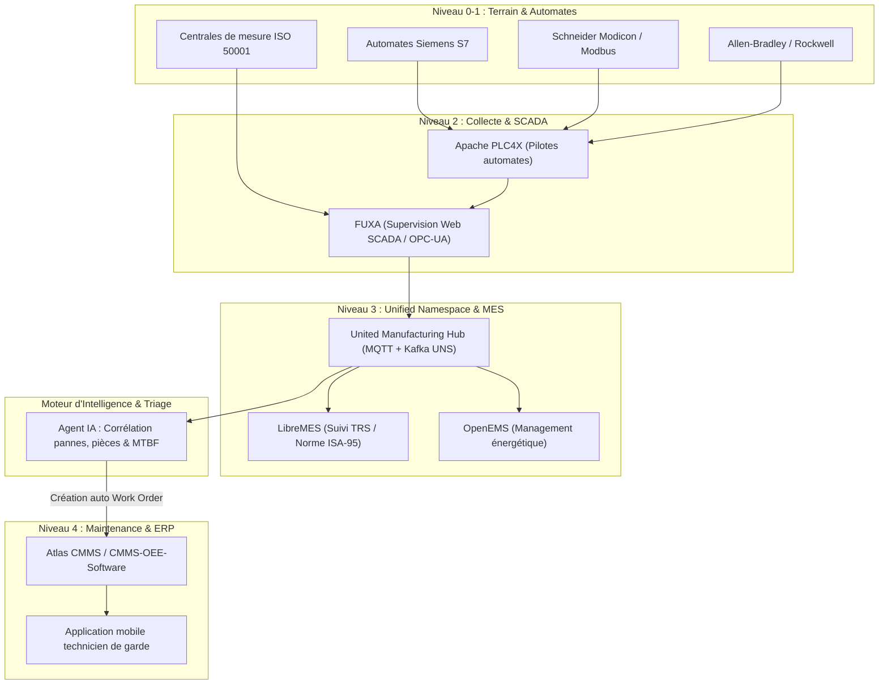

# Prodeos Industrial Engineering & OT/IT Convergence

Compétence spécialisée dans l'ingénierie industrielle, l'interfaçage terrain-IT et la maintenance prédictive, calquée sur les solutions déployées par **Prodeos**.

---

## 1. Vue d'Ensemble & Briques Technologiques de Référence



### Dépôts GitHub fondateurs :
1. **[LibreMES](https://github.com/LibreMES/LibreMES)** : Suivi d'atelier, traçabilité des arrêts et calcul de TRS (OEE) conforme à la norme **ISA-95**.
2. **[United Manufacturing Hub (UMH)](https://github.com/united-manufacturing-hub/united-manufacturing-hub)** : Socle d'architecture Industrie 4.0 avec **Unified Namespace (UNS)** reliant MQTT (edge temps réel) et Apache Kafka (streaming événementiel d'entreprise).
3. **[FUXA](https://github.com/frangoteam/FUXA)** : SCADA et IHM Web open-source multi-protocoles (OPC-UA, Modbus, MQTT, S7).
4. **[Apache PLC4X](https://github.com/apache/plc4x)** : Drivers d'automates natifs sans licences propriétaires.
5. **[OpenEMS](https://github.com/OpenEMS/openems)** : Plateforme de management de l'énergie et télérelève industrielle (ISO 50001).
6. **[Atlas CMMS](https://github.com/grashjs/cmms)** : GMAO API-first pour la gestion des bons d'intervention et des pièces de rechange.

---

## 2. Le Unified Namespace (UNS) & Topologie ISA-95

Dans une intégration Prodeos, les données ne sont pas échangées en silos point-à-point, mais publiées sur un bus universel structuré selon l'arborescence **ISA-95** :

```
enterprise / site / area / line / cell / payload_type
```

### Exemples de topics UNS :
* `prodeos-demo/usine-paris/atelier-usinage/ligne1/cnc-01/telemetry/vibration`
* `prodeos-demo/usine-paris/atelier-usinage/ligne1/cnc-01/alarms/thermal`
* `prodeos-demo/usine-paris/energie/tgbt-principal/power_kw`
* `prodeos-demo/usine-paris/mes/ligne1/oee`

---

## 3. Workflow Métier : Détection Terrain vers Déclenchement GMAO

```
[ Capteur / Automate ] 
       │ (Seuil dépassé : ex Température broche > 75°C)
       ▼
[ FUXA / PLC4X ] 
       │ (Publication JSON sur topic MQTT UNS)
       ▼
[ UMH (Unified Namespace) ]
       │ (Streaming événementiel Kafka)
       ▼
[ Agent IA Prodeos ]
       │ 1. Évalue la gravité (CRITICAL / HIGH)
       │ 2. Vérifie le MTBF de l'équipement
       │ 3. Identifie la référence de la pièce (ex: Pompe lubrification SKU-LUB-88)
       │ 4. Vérifie le stock magasin disponible
       ▼
[ API GMAO Atlas ]
       │ (POST /api/v1/work-orders/)
       ▼
[ Bon d'intervention créé avec technicien affecté & pièce réservée ]
```

---

## 4. Scripts & Simulateurs Inclus

Le script de simulation [`scripts/simulate_prodeos_bridge.py`](file:///C:/Users/user/.gemini/config/skills/prodeos-industrial-convergence/scripts/simulate_prodeos_bridge.py) permet de tester de bout en bout la chaîne événementielle :
* Envoi d'une alarme télémétrique simulant un automate Siemens S7 via FUXA.
* Traitement intelligent de l'alarme (analyse de seuil, historique d'arrêts et pièces requises).
* Génération du bon de travail GMAO formaté JSON avec persistance et notification.
